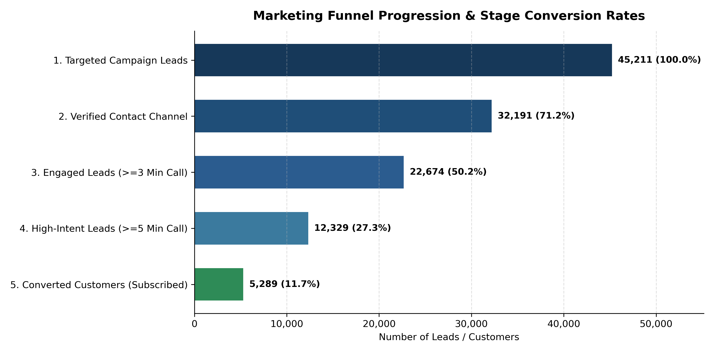
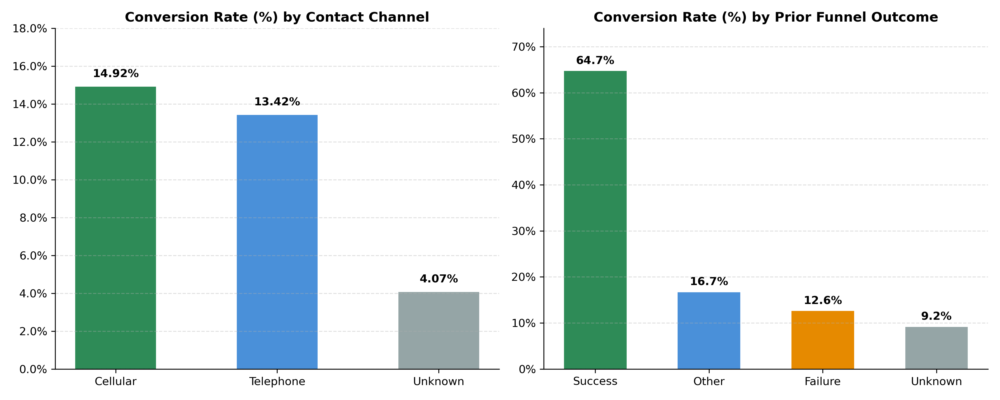
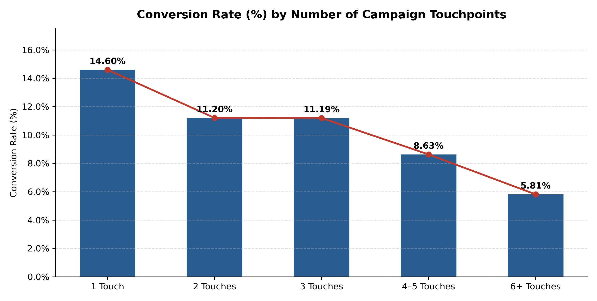
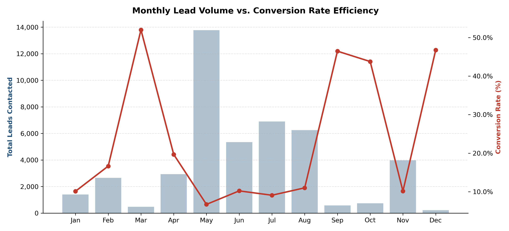

# Marketing Funnel & Conversion Performance Analysis (`FUTURE_DS_03`)

**Track:** Data Science & Analytics — Task 3 (Future Interns)  
**Author:** Casebar Mkhari | BSc Applied Mathematics & Statistics (UNISA)  
**Tools Used:** Python (`Pandas`, `NumPy`, `Matplotlib`, `Seaborn`, `Statsmodels`), Jupyter Notebook  

---

## 1. Executive Summary & Business Problem
To optimize customer acquisition efficiency and eliminate wasted outreach spend, this project analyzes **45,211 marketing campaign leads** from the Bank Marketing dataset. The analysis maps lead progression across a five-stage conversion funnel, diagnoses stage-by-stage drop-off bottlenecks, evaluates acquisition channel performance, quantifies diminishing returns from repeated follow-ups, and models statistically significant conversion drivers.

### Core Funnel & Conversion KPIs
| Metric | Value |
| :--- | :--- |
| **Total Targeted Leads** | **45,211** |
| **Total Converted Customers** | **5,289** |
| **Overall Funnel Conversion Rate** | **11.70%** |
| **Average Engagement (Converted)** | **537.3 seconds (~9.0 mins)** |
| **Average Engagement (Non-Converted)** | **221.2 seconds (~3.7 mins)** |

---

## 2. Key Analytical Findings

### A. Multi-Stage Marketing Funnel & Drop-Off Bottlenecks
Tracking all 45,211 targeted leads through progressive qualification stages exposes two primary conversion bottlenecks:
1. **Unverified Channel Leakage (`28.80%` initial drop-off):** **13,020 leads** (`28.8%` of the funnel) lacked a verified contact channel (`unknown`), converting at just **4.07%** compared to **14.92%** on cellular outreach.
2. **High-Intent Closing Gap (`57.10%` final-stage drop-off):** Of the **12,329 high-intent leads** who engaged for 5+ minutes, **42.90%** (`5,289`) converted—leaving **7,040 deeply engaged prospects** unconverted at the final decision step.

| Funnel Stage | Lead Count | % of Total Funnel | Stage Conversion (%) | Stage Drop-Off (%) |
| :--- | :---: | :---: | :---: | :---: |
| **1. Targeted Campaign Leads** | 45,211 | 100.00% | 100.00% | 0.00% |
| **2. Verified Contact Channel** | 32,191 | 71.20% | 71.20% | 28.80% |
| **3. Engaged Leads ($\ge 3$ Min Call)** | 22,674 | 50.15% | 70.44% | 29.56% |
| **4. High-Intent Leads ($\ge 5$ Min Call)** | 12,329 | 27.27% | 54.38% | 45.62% |
| **5. Converted Customers (Subscribed)** | 5,289 | 11.70% | 42.90% | 57.10% |



### B. Acquisition Channel & Retargeting Performance
* **Cellular Outreach Leads Volume & Efficiency:** Verified **cellular** campaigns generated **4,369 conversions** (`82.6%` of all acquisitions) at a **14.92%** conversion rate, outperforming landline telephone (`13.42%`) and unverified channels (`4.07%`).
* **Warm Retargeting Multiplier:** Leads with a **successful prior campaign outcome** (`poutcome = success`) converted at **64.73%** (978 of 1,511 leads)—more than **7x higher** than cold/untracked leads (`9.16%`). Even leads marked `other` (`16.68%`) or `failure` (`12.61%`) outperformed first-time cold outreach.



### C. Diminishing Returns on Repeated Follow-Up Touchpoints
* Conversion efficiency peaks on the **first contact touchpoint (14.60%)** and declines steadily with repeated follow-ups: **11.20%** at 2 touches, **11.19%** at 3 touches, **8.63%** at 4–5 touches, and **5.81%** at 6+ touches.
* **9,641 leads** received 4 or more campaign touches yet yielded only **709 conversions** (`7.35%` combined rate), representing significant call-center fatigue and wasted outreach capacity.



### D. Seasonal Volume vs. Conversion Efficiency Mismatch
* Campaign outreach volume is heavily concentrated in **May (13,766 leads)**, **July (6,895 leads)**, and **August (6,247 leads)**, which post the lowest conversion rates of the year (**6.72%**, **9.09%**, and **11.01%**, respectively).
* Conversely, off-peak quarters achieve exceptional conversion efficiency: **March (51.99%)**, **December (46.73%)**, **September (46.46%)**, and **October (43.77%)**.



### E. Statistical Conversion Drivers (Logistic Regression Odds Ratios)
A multivariable Logistic Regression model ($p < 0.0001$ across all predictors) quantifies the independent impact of each funnel factor on conversion odds:
* **Prior Campaign Success (`OR = 13.0500`):** Increases the odds of conversion by **13.05x**, confirming warm retargeting as the single highest-leverage growth driver.
* **Verified Cellular Channel (`OR = 3.7275`):** Increases conversion odds by **3.73x** compared to unverified contact records.
* **Engagement Duration (`OR = 1.2701` per minute):** Each additional minute of meaningful conversation increases conversion odds by **27.0%**.
* **Excessive Touchpoints (`OR = 0.8819` per touch):** Each additional follow-up call reduces conversion odds by **11.8%**, statistically confirming diminishing returns.
* **Existing Debt Obligations:** Carrying a **housing loan (`OR = 0.4345`)** or **personal loan (`OR = 0.5150`)** reduces term-deposit subscription odds by **56.6%** and **48.5%**, respectively.

---

## 3. Actionable Growth & Funnel Optimization Recommendations
1. **Cap Outreach Frequency at 3 Touchpoints per Lead:** Reallocate call-center hours spent on 4+ follow-up attempts (`9,641 leads` converting at `7.35%`) toward fresh verified cellular leads (`14.92%` conversion) and warm retargeting segments.
2. **Prioritize Warm Retargeting Segments (`64.73%` Conversion):** Build an automated priority queue for leads with prior campaign engagement (`poutcome = success` or `other`), as they convert at **13x the odds** of cold prospects.
3. **Enforce Pre-Campaign Phone Verification:** Eliminate the `28.80%` unverified channel drop-off (`4.07%` conversion) by running automated number validation and enrichment before launching outbound campaigns.
4. **Rebalance Campaign Budgets Toward High-Converting Windows:** Shift outreach capacity from oversaturated summer months (May–August, `6.7%–11.0%` conversion) into under-utilized high-intent windows (March, September, October, and December, `43.8%–52.0%` conversion).
5. **Deploy Late-Stage Closing Scripts for 5+ Minute Calls:** Equip agents with targeted objection-handling offers for high-intent leads who cross the 5-minute threshold (`57.1%` current drop-off) and tailor low-minimum savings products for mortgage/loan holders.

---

## 4. Repository Structure
```text
FUTURE_DS_03/
├── data/
│   └── marketing_funnel_cleaned.csv        # Cleaned dataset with engineered funnel stages
├── visuals/
│   ├── 01_marketing_funnel_progression.png
│   ├── 02_channel_and_retargeting_conversion.png
│   ├── 03_touchpoint_diminishing_returns.png
│   └── 04_monthly_volume_vs_conversion.png
├── marketing_funnel_analysis.ipynb         # Python EDA, funnel metrics, logistic regression & charts
└── README.md                               # Executive report & growth recommendations
